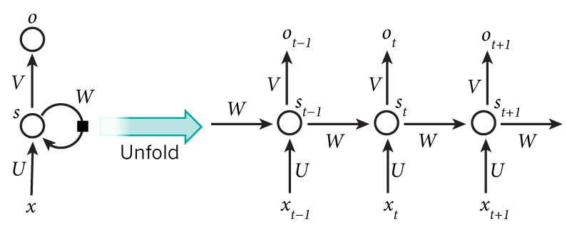
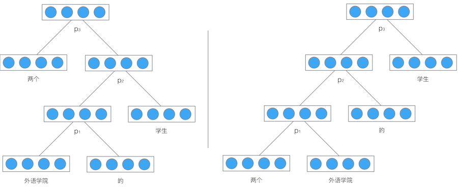
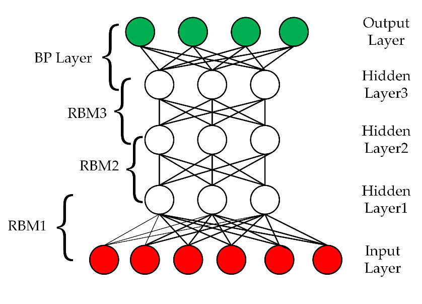
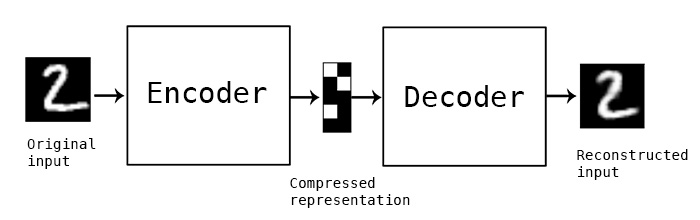
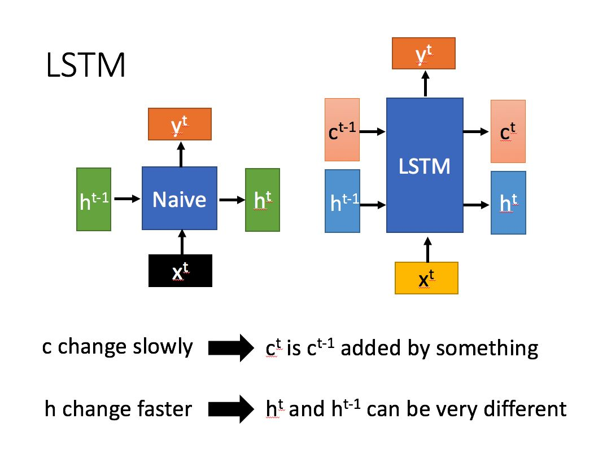

## **A. Categories**

- **Traditional Methodologies**

(1) Supervised Learning(监督学习)
: 通过对标记过的数据进行训练推导出预测函数，标记过的是指每个训实例都包含输入($$ \vec x $$)和预期输出($$ \vec y $$)，本质上使用Classification

(2) Unsupervised Learning(无监督学习)
: 数据样本没有被人工标记过，即数据的特征没有标签(label)，依靠算法自己把特征相似的归类，本质上使用Clustering

(3) Reinforcement Learning(强化学习)
: 没有大量数据作为输入，而是在某种特定场景下，算法通过尝试合适的方法使得到的奖励最大化的方法，特点是特定的应用场景+对于希望做的事有奖励，没有标签，只有环境给出的奖励和惩罚

- **Hybrid Methodologies**

(1) Self-Supervised Learning(自监督学习)
: 用于训练的数据标记来自于机器自己产生的标签，而非人工标记，会有一个辅助任务(pretext task)进行一系列操作为训练样本生成标签，训练好这个辅助任务模型就是自监督的根本(本质是一个特征提取器)

(2) Weakly Supervised Learning(弱监督学习)
: - **incomplete supervision(不完全监督)**: 少量标记样本和大量无标记样本，样本集表现为$$ D = \{(x_1, y_1), \cdots, (x_m, y_m), \cdots, x_n\} $$，f: X -> Y，样本集中有m个标记样本与n-m个无标记样本

  - **inexact supervision(不确切监督)**: 样本只有非常general的标签，比如一张代表肺部X光图片进行分类时，我们只知道某张图片是肺炎患者的肺部图片，但是并不知道具体图片中哪个部位的响应说明了该图片的主人患有肺炎，样本集表现为$$ D = \{ (X_1, y_1), \cdots, (X_m, y_m)\} $$, f: X -> y，其中$$ X_i = \{x_i1, \cdots, x_im_i\} \subseteq X $$被称为一个bag，样本集D中的数据单位是bag，一个bag中含有多个instance $$ x_ij $$，如果**所有**的instance都标记为negative，那这个bag就是negative，反之(只要有一个是positive)则bag为positive

  - **inaccurate supervision(不准确监督)**：给定的标签不一定全对，即训练集样本中存在错误的标记结果。

(3) Multiple Instance Learning(多示例学习)
: 同(2)中inexact supervision

- **Learning Techniques**

(1) Semi-Supervised Learning(半监督学习)
: 是弱监督学习的一种特例，结合少量的标记数据和大量的无标记数据进行训练，能够大量节省labeling花费的人工，同时比纯粹的unsupervised learning表现要好

(2) Multi-task Learning(多任务学习)
: 给定m个学习任务，其中所有或者一部分任务是相关但不相同的，MTL通过同时使用这m个任务中的数据(一定程度上共享参数)来提升学习效率和表现(因为如果分开，只专注于单个模型可能会忽略掉相关任务中一些有益的潜在信息)

(3) Deep Learning(深度学习)
: 使用多层神经网络模拟人脑进行分析学习的方法。主要使用深度神经网络DNN，即除了输入层和输出层还有>=1个隐层，隐层通过学习实现了对数据的抽象表达，类比人类的认知系统。具有出色的准确率，但是代价是很高的计算量成本，常用有以下模型:

  - **Fully Connected Neural Networks(全连接神经网络)**：对n-1层的每个节点都和第n层的节点连接的神经网络

  - **Convolutional Neural Networks(卷积神经网络)**: 至少在一层中使用卷积代替常规矩阵乘法的神经网络

  - **Recursive Neural Networks(递归神经网络)**：分为Recurrent NN(循环神经网络)和Recursive NN(递归神经网络) 
  
    (1) Recurrent是时间维度上的展开，对有序列关系的输入进行处理时多会采用这种方法，把长度不定的输入分为等长度的小块并循环输入到输入层(固定的单元个数)，x是输入层的值，s是隐藏层的值，o是输出层的值，基本结构展开如图：
    
    
    (2) Recursive是空间维度上的树结构展开，对于更为复杂的信息结构如树、图等，Recurrent NN难以处理，或者不能用简单的线性顺序描述的结构，就会选择Recursive NN，但是成本较高，输入样本是树/图，难以标注，基本结构如图，向量$$ p_3 $$就是对这条语句两种含义的最终代表：
    

  - **Deep Belief Networks(深度置信网络)**：是一种包含多层隐单元的feedforward深度结构，每一层都是典型的受限玻尔兹曼机(Restricted Boltzmann Machine, RBM)，RBM分为上层(隐层)和下层(显层)，前一个RBM的输出层(隐层)作为下一个RBM的输入层(显层)，最后加上一层输出层就构成了DBN的基本结构: 
  

  - **Generative adversarial Networks(生成对抗网络)**: 由一个生成网络(Generator)和一个判别网络(Discriminator)组成，通过让两个网络互相博弈进行学习。生成网络从latent space随机取样当作输入，输出则尽量模仿训练集中的真实样本，目标是欺骗判别网络，判别网络则用真实样本和生成网络的输出作为输入，目标是把生成网络的样本和真实样本区别开来，达到最后判别网络无法区分的程度。

  - **Auto-encoder(自编码器)**：由输入层、隐藏层(编码器Encoder)和输出层(解码器Decoder)组成，作用是降维、降噪和异常检测。Encoder把输入样本x提取特征转换成h，Decoder把h转换成$$ \overline x $$，求解使x和$$ \overline x $$最接近的Encoder与Decoder，所以前半部分是特征提取器，后半部分是重构，如果把$$ \overline x $$再输入Encoder反复训练，则能得到针对此类样本的高性能自编码器，结构如下：
  

  - **Long Short-term Memory Networks(长短时记忆网络)**：是一种Recurrent NN，针对普通的Recurrent NN训练中可能发生gradient exploding(梯度爆炸)或者gradient vanishing(梯度消失)，Recurrent NN中隐藏层原先只有一种对短期输入敏感的状态h，增加一种保存长期状态的c，这样梯度变化就不会极端化了，基本结构：
  

(4) Transfer Learning(迁移学习)
: 把一个预训练好的模型微调后运用在另一个任务中。前提是这个模型提取的特征是泛化的，overfit的特征迁移后没有作用，所以有时会只取模型的前几层网络。

(5) Curriculum Learning(课程学习)
: 模仿人类学习过程，让模型先从容易的样本开始学习，逐渐进阶到更复杂的样本。基本结构上由Difficulty Measurer + Training Scheduler组成，DM实现一个ranking func来给出每个样本的学习优先程度(样本的难易区分)，TS实现放入高难度样本的时机选择及数量。
  
(6) Federated Learning(联邦学习)
: 

(7) Active Learning(主动学习)
: 

(8) Confident Learning(置信学习)
: 

## **B. Terminology**

- Cost function(代价函数)
  - 基本形式为$$ J(w) = \sum (wx - y)^2 $$  
  - 概念上任何衡量真实值y和模型预测值f(x)之间差异的函数都可以算cost function。对每种算法，cost function不唯一，而且越小证明越符合训练集样本(本质是预测差)，当取到cost function $$ J(w) $$的最小值时，就得到了最优的参数$$ w $$，即$$\underset{w}{\mathrm{min}} J(w) $$
- Regularization(正则化)
  - 在计算cost function时加入正则项的操作叫做正则化，目的是防止过拟合的发生  
  - 原理上是在cost function上加某些限制，缩小可能的解空间  
  - 基本形式上为$$ J(w) = \underset{\vec{\hat w}}{\mathrm{argmin}}(J(w) + \lambda \Omega(w)) $$，其中$$ \Omega(w) $$即为正则项，$$ \lambda $$则是用于控制正则项重要程度的参数，正则项通常包括对光滑度及向量空间内范数上界的限制  
  - 常见正则项:  
    - 定义：$$ L_p(\vec x) = \|\vec x\|_p = (\sum_{i=1}^n\|x_i\|^p )^{\frac 1 p} $$为$$ L_p $$-norm
    - p = 0, $$ L_0 $$正则项($$ L_0-norm $$)
    > 基本形式为$$ \gamma_0 \frac {\|{\vec w}\|_0} n, \gamma_0 > 0 $$，较少使用
    - $$ L_1 $$正则项($$ L_1-norm $$)
    > 基本形式为$$ \gamma_1 \frac {\|{\vec w}\|_1} n, \gamma_1 > 0 $$  
    > 通过特征$$ x_i $$的绝对值之和实现正则化，有利于得到稀疏解，起到特征选择的作用
    - $$ L_2 $$正则项($$ L_2-norm $$)
    > 基本形式为$$ \gamma_2 \frac {\|{\vec w}\|_2} n, \gamma_2 > 0 $$  
    > 通过特征$$ x_i $$的平方和实现正则化(根号不影响忽略)，有利于得到平滑解，起到防止过拟合作用

- Normalization(归一化)

- Underfitting(欠拟合)/Overfitting(过拟合)
  - 欠拟合：相较于数据而言，模型参数过少或者模型结构过于简单，对训练样本的一般性质尚未学好
  - 过拟合：过于紧密的匹配特定数据集，把训练集自身的部分特征当作了所有样本的一般特征

## **C. Regression**
> 回归是用来分析事件发展规律、预测(有限程度上)未发生事件结果的统计学方法  
> is a statistical method that tries to fit a model to data, in order to quantify the relationship between the outcome variable and the predictor variables.

### 1. Linear Regression(线性回归)

- 1.1 定义：
  - 线性模型是尝试用一个由属性的线性组合来进行预测的模型，通常表达为向量形式的$$ \vec f(x) = \vec w ^ T\vec x + b $$，其中$$ \vec w ^ T = (w_1; w_2;...;w_d) $$，$$ \vec w $$和b通过学习样本训练确定后就可以确定模型了  
  - 线性模型形式简单，是很多功能更加强大的非线性模型的基础，且由于$$ \vec w $$相当于各项属性中的权重，能更加直观的表现各项属性在预测中的重要性  

- 1.2 模型
  > $$ \vec f(\vec x_i) = \vec w ^ T\vec x_i + b $$，试图使每个$$ f(x_i) \simeq y_i $$

- 1.3 $$ \vec w $$与b的计算
  > **最小二乘法(Least Square)**  
     > 为了方便计算，取$$ \vec{\hat w} = (\vec w; b) $$，训练集D的$$ \vec x_i $$ 表示为:  
     > $$\qquad \qquad \vec X = \begin{Bmatrix} x_{11} & x_{12} & \cdots & x_{1d} & 1\\x_{21} & x_{22} & \cdots & x_{2d} & 1 \\\vdots & \vdots & \ddots & \vdots & \vdots\\x_{m1} & x_{m2} & \cdots & x_{md} & 1\\\end{Bmatrix} $$ = $$ \begin{Bmatrix} x_1^T & 1\\x_2^T & 1\\\vdots & \vdots\\x_m^T & 1\\\end{Bmatrix} $$,  
     > 训练集D的$$ y_i $$表示为$$ \vec y = (y_1; y_2;...;y_m) $$  
     > 可得$$ \vec{\hat w^*} = \underset{\vec{\hat w}}{\mathrm{argmin}}(\vec y - \vec X \vec{\hat w})^T(\vec y - \vec X \vec{\hat w}) $$，此为最小二乘法公式  
     > 令$$ g(x) = (\vec y - \vec X \vec{\hat w})^T(\vec y - \vec X \vec{\hat w}) $$，并对$$ \vec{\hat w} $$求导可得：  
     > 
 $$ \frac{\partial g(x)}{\partial \vec{\hat w}} = 2 \vec X^T (\vec X \vec{\hat w} - \vec y) $$ 
  
     > 当$$ \vec x^T \vec X $$为满秩矩阵或正定矩阵时，令=0可解得:  
     > 
 $$ \vec{\hat w^*} = (\vec X^T X)^{-1} \vec X^T \vec y $$ 
  
     > 进一步令$$ \vec{\hat x_i} = (\vec x_i ,1) $$，代入$$ \vec f(\vec x_i) = \vec w ^ T\vec x_i + b $$可得：  
     > 
 $$ f(\vec{\hat x_i}) = \vec{\hat x_i^T} (\vec X^T \vec X)^{-1} \vec X^T \vec y $$ 
  
     > 简写线性模型为：  
     > 
 $$ y = \vec{w^T} \vec x + b $$

- 1.4 Multivariable Linear Regression(多元线性回归)
  - 模型：$$ y = \beta_0 + \beta_1 x_1 + \beta_2 x_2 + \cdots + \beta_p x_p $$
  - 计算方法与一元线性回归类似，只是求导时对每个系数求偏导，计算较复杂

- 1.5 Gradient Descent(梯度下降)

### 2. Ridge Regression(岭回归)

### 3. Lasso Regression(套索回归)}

### 4. Logistic Regression(逻辑回归)

### 5. Polynomial Regression(多项式回归)

### 6. Stepwise Regression(逐步回归)

## **D. KNN**

## **E. Clustering**

### 1. K-means

### 2. LDA(Latent Dirichlet Allocation)

## **F. Demension Reduction**

### 1. PCA(Principle Component Analysis)

### 2. Kernal PCA

### 3. LLE(Locally Linear Embedding)

## **G. Decision Tree**

## **H. Random Forest**

## **I. Q&A**

### 1. Muiti Task Learning vs Transfer Learning

> MTL中多个任务同时进行，目的是让这些任务之间互相有所帮助，Transfer Learning则是先学习任务A，再迁移到任务B，利用A的结果帮助B

